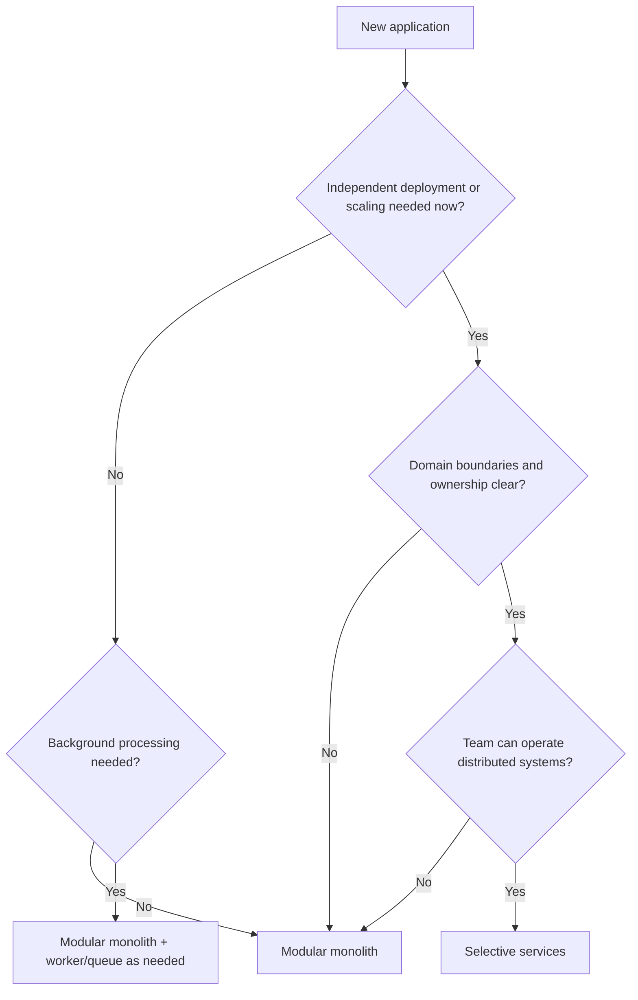
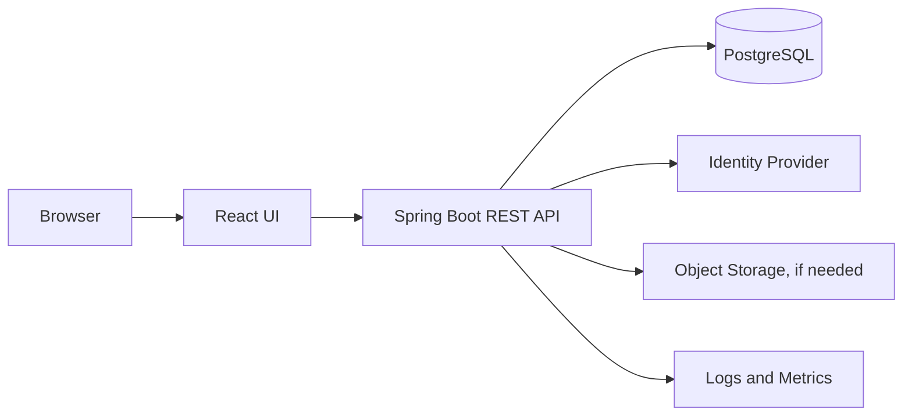

# 02 — Architecture Selection

## Default recommendation

For most new business applications, start with a **modular monolith**: one deployable application with clear internal module boundaries. Add workers or a queue if asynchronous work requires them. Extract services only when there is a measurable reason.

## Decision tree

## Compare styles

| Style | Advantages | Disadvantages | Use when |
|---|---|---|---|
| Monolith | Simple deployment and local calls | Can become tightly coupled | Small scope, simple domain |
| Modular monolith | Clear modules without distributed operations | Shared runtime and release | Strong default for business apps |
| Microservices | Independent deployment/scaling and ownership | Network failure, tracing, consistency, operations | Multiple domains/teams need real independence |
| Event-driven | Decoupled consumers, async processing | Eventual consistency and harder debugging | Notifications, integrations, workflows |
| Serverless | Less server management, elastic execution | Runtime limits and pricing variability | Suitable event-driven or intermittent workloads |

## Example baseline

Add a queue, worker, CDN, replicas, or separate services only when requirements justify them.

## Reasons to extract a service

- A domain needs an independent release cycle.
- A workload has materially different scaling needs.
- Team ownership requires a stable service boundary.
- Isolation requirements justify a separate runtime or data boundary.
- A module repeatedly blocks unrelated changes.

Before extraction, define service ownership, API contract, data ownership, retries, timeouts, observability, deployment, and failure handling.

## Common traps

- Microservices because they sound more scalable.
- Shared database tables that couple supposedly independent services.
- Distributed transactions without a clear consistency model.
- No local development or tracing strategy.
- Extracting services before domain boundaries are understood.
