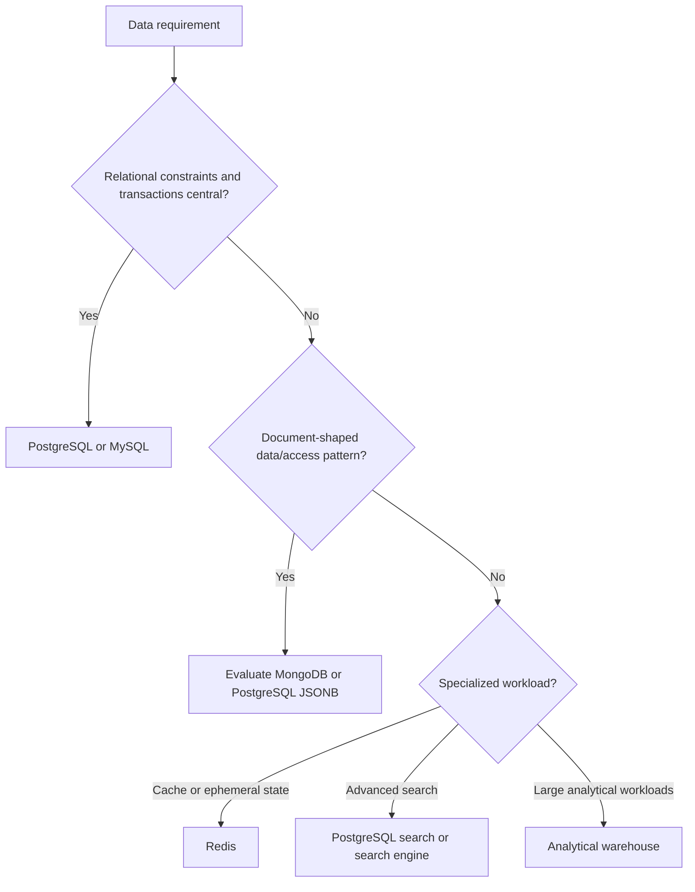

# 03 — Database Selection

## Default

Use PostgreSQL as the primary data store for most transactional business applications. Select another technology when its data model or workload provides a concrete benefit.

## Decision tree



## Comparison

| Store | Good fit | Caution |
|---|---|---|
| PostgreSQL | Relational data, transactions, complex queries, JSONB | Still requires query/index tuning and capacity planning |
| MySQL | Relational workloads and existing MySQL expertise | Migration is not always zero-effort |
| MongoDB | Document-oriented access patterns | Do not choose simply to avoid schema design |
| Redis | Cache, rate limits, selected ephemeral data structures | Define durability and source-of-truth boundaries |
| Elasticsearch/OpenSearch | Search relevance, text search, search analytics | Usually not the transactional system of record |
| Analytical warehouse | Reporting and large analytical scans | Not a replacement for an ordinary OLTP database |

## Selection questions

1. Are relationships, constraints, and transactions central?
2. What are the top read and write queries?
3. What latency and throughput targets are required?
4. What are data size and growth estimates?
5. What are backup, restore, retention, and recovery requirements?
6. Can the team operate and tune the chosen database?
7. What are hosting, egress, and migration costs?

## Spring Boot considerations

- Use migrations (for example, Flyway or Liquibase) to version schema changes.
- Use transactions deliberately; avoid long-running transactions.
- Add indexes based on query plans and workload.
- Use connection pooling and budget connections across all replicas/workers.
- Keep credentials out of source control.
- Test backups by restoring them, not just by checking that a backup job ran.

## Example schema

```sql
CREATE TABLE orders (
    id BIGINT GENERATED ALWAYS AS IDENTITY PRIMARY KEY,
    customer_id BIGINT NOT NULL,
    status VARCHAR(30) NOT NULL,
    total_amount NUMERIC(12, 2) NOT NULL CHECK (total_amount >= 0),
    created_at TIMESTAMPTZ NOT NULL DEFAULT NOW()
);
```

This is illustrative. Add foreign keys, indexes, currency handling, and domain-specific constraints as needed.

## When to add another data store

Add Redis, a search engine, or an analytical store only when a distinct requirement and measured benefit justify its cost and operational burden.
