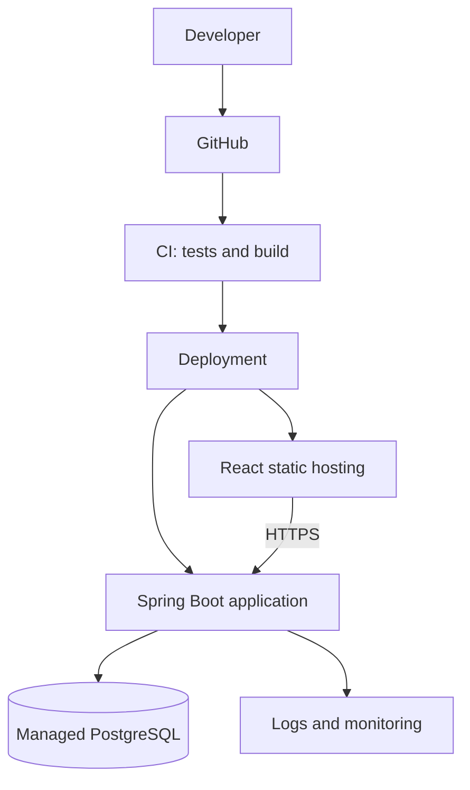

# 04 — Hosting Selection

## Choose by operational responsibility

| Option | Suitable for | Main trade-off |
|---|---|---|
| Static hosting/CDN | React production build | Does not run a traditional Spring Boot process |
| Managed application platform | Spring Boot API/worker | Less operations; provider limits and pricing vary |
| Managed container platform | Dockerized services | More control than some app platforms without full Kubernetes burden |
| VPS | Small apps with capable operator | You own more patching, hardening, backups, and recovery |
| Cloud VMs | Custom environments | More control and more infrastructure work |
| Kubernetes | Many services or complex scheduling/deployment needs | Significant platform and operational overhead |
| Serverless | Supported event-driven/intermittent workloads | Runtime limits, cold starts in some cases, usage variability |

## Starter deployment

## Managed hosting vs VPS

| Factor | Managed platform | VPS |
|---|---|---|
| Initial setup | Usually easier | Server configuration needed |
| OS patching | Mostly provider-managed | Operator responsibility |
| Deployment | Often integrated | Configure pipeline/tooling |
| Price | Plan and usage dependent | Low entry price may hide labor and recovery cost |
| Scaling | Platform-dependent | Self-configured unless additional services are used |
| Best for | Fast delivery, small operations team | Experienced operator needing control |

## Production checks

- Confirm persistent storage requirements; application filesystems may be ephemeral.
- Confirm database backups and point-in-time recovery options.
- Confirm region, data residency, network access, and egress pricing.
- Confirm service sleep/idle behavior and resource limits.
- Keep secrets in secure configuration or a secret manager.
- Configure HTTPS, health checks, logs, alerts, and deployment rollback.
- Test restore and redeployment procedures.

## Rule

For a small client project, prefer managed hosting when it materially reduces operational risk. Choose a VPS only if someone explicitly owns patching, access control, monitoring, backup, and incident response.
