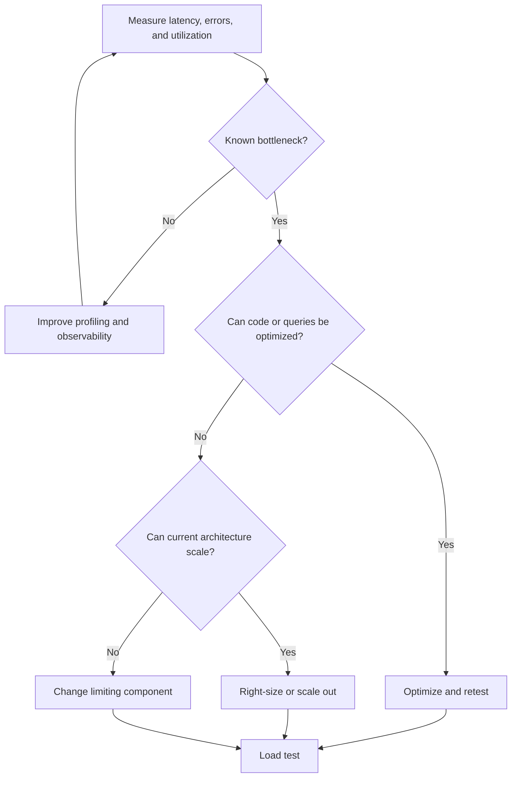

# 09 — Cost and Scaling

## Total cost of ownership

```text
TCO = Build + Infrastructure + Operations + Maintenance + Migration
```

Use a consistent horizon, such as 12 or 36 months. Include engineering labor when comparing designs with different operational complexity.

## Monthly cost categories

| Category | Include |
|---|---|
| Frontend | Hosting, CDN, bandwidth |
| Backend | Compute, memory, replicas, workers |
| Database | Compute, storage, backups, replicas |
| Storage | Capacity, requests, retention |
| Network | Egress, gateways, load balancers |
| Security | Identity, secrets, scanning, tooling |
| Observability | Logs, metrics, traces, retention |
| Messaging | Queue/broker operations and retention |
| Third parties | Email, SMS, payments, maps, AI APIs |
| People | Maintenance, on-call, incidents, upgrades |

## Budget profiles

| Profile | Starting architecture | Watch for |
|---|---|---|
| Prototype | Minimal frontend/backend/data services | Free-tier limits and data loss |
| Low-budget MVP | One backend instance and small database plan | Backup, availability, egress, minimum plan cost |
| Growing product | Add capacity based on metrics; managed database and monitoring | Replicas, storage growth, observability bills |
| Enterprise | Multiple environments, recovery, controls, monitoring | Redundancy, networking, support, staffing |

Verify current provider pricing before committing. Model normal usage, peak usage, and recovery/failover. Do not remove essential security or backups to save money.

## Scaling sequence



## Scaling techniques

| Technique | Trigger | Risk |
|---|---|---|
| Index/query tuning | Slow queries | Write overhead and storage |
| Horizontal API scaling | Compute/concurrency limit | Shared state and downstream limits |
| Connection pooling | Connection overhead | Aggregate connections across replicas |
| Cache | Repeated expensive reads | Staleness and invalidation |
| Queue/worker | Slow background work | Retry and observability complexity |
| Read replica | Read capacity pressure | Replication lag |
| Partitioning | Data size/query patterns justify it | Migration and operational complexity |
| Microservices | Independent ownership/deployment/scaling value | Distributed failure and overhead |

## Connection-pool example

Four Spring Boot replicas configured for 30 database connections each could allow up to 120 application connections. Include workers, migrations, and administrative connections in the database budget. More API replicas can overload a database if connection limits are not planned.

## Revisit triggers

Record concrete signals such as p95 latency exceeding an agreed SLO, database saturation, queue lag, failed recovery tests, or operational cost exceeding budget. Avoid arbitrary user-count thresholds without workload evidence.
