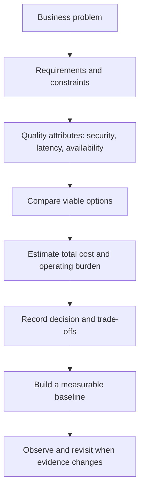

# 01 — Decision Frameworks

This section helps answer **what to choose, why to choose it, what it costs, and when to revisit the decision**.

## Decision flow

## Pages

| Page | Purpose |
|---|---|
| [01 Technology Selection](01-technology-selection.md) | Select a stack against requirements |
| [02 Architecture Selection](02-architecture-selection.md) | Choose monolith, modular monolith, services, or event-driven patterns |
| [03 Database Selection](03-database-selection.md) | Select a data store based on data and access patterns |
| [04 Hosting Selection](04-hosting-selection.md) | Choose deployment style and hosting responsibility |
| [05 Cloud Selection](05-cloud-selection.md) | Compare AWS, Azure, and Google Cloud based on context |
| [06 Authentication Selection](06-authentication-selection.md) | Choose identity and access patterns safely |
| [07 API and Integration Selection](07-api-and-integration-selection.md) | REST, GraphQL, gRPC, webhooks, and messaging |
| [08 Caching and Messaging](08-caching-and-messaging.md) | Decide when to add cache, queues, or event streams |
| [09 Cost and Scaling](09-cost-and-scaling.md) | Model total cost and scale based on measured bottlenecks |
| [10 ADR Template](10-architecture-decision-record-template.md) | Record important technical decisions |

## Universal decision checklist

- [ ] Business requirements and constraints are written down.
- [ ] Mandatory security, compliance, and reliability needs are identified.
- [ ] At least two viable alternatives are considered.
- [ ] Build, hosting, maintenance, and migration costs are considered.
- [ ] Team skill and operational ownership are clear.
- [ ] Failure modes, backups, and recovery are considered.
- [ ] The decision has measurable validation criteria.
- [ ] Conditions for revisiting the decision are recorded.
