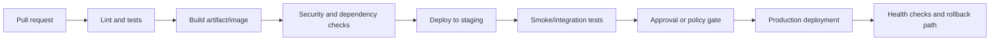

# 03 — Cloud and DevOps

## Planned reference pages

- Docker fundamentals and production images
- CI/CD with GitHub Actions
- Environment and secret management
- AWS / Azure / Google Cloud service mapping
- Infrastructure as Code
- Logging, metrics, tracing, and alerting
- Backup and disaster recovery
- Release strategies: rolling, blue-green, canary
- Kubernetes: when it is worth operating

## Delivery pipeline

Keep production credentials out of repository files. Use short-lived or federated credentials where supported.
